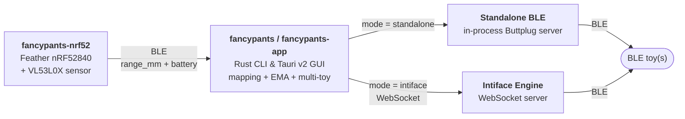

# Fancypants


<br/>
A wearable proximity & motion controller that uses an Adafruit Feather nRF52840
+ VL53L0X time-of-flight sensor (`fancypants-nrf52`) to drive Buttplug-compatible
toys via the `fancypants` Rust middleware and Tauri v2 GUI app (`fancypants-app`
for Linux, Windows, and Android).

"Wave your hand" closer to the sensor for more intensity, pull away to reduce
it — or flip it around, drive intensity by how fast you're moving, pulse
individual actuators, or control multiple toys at once with independent mappings
(see [docs/middleware.md](docs/middleware.md)). Toys can connect **directly over
BLE** using the built-in standalone engine or through **Intiface Central /
Engine** over WebSocket.



## Quick start

Prebuilt binaries are on the [Releases page](../../releases) for **Linux**
(`.deb`, `.rpm`, `.AppImage`, `.tar.gz`), **Windows** (`.zip`), **Android**
(`arm64` `.apk`), and the **Feather nRF52840** (`.uf2`) — download, flash, run.

To build from source on Linux you only need `docker` (or `podman`) and `make`
(or `nix` on NixOS):

```bash
# 1. Build firmware + CLI middleware, and optionally the Tauri v2 GUI app
make
make app

# 2. Flash the Feather: double-tap reset, then copy the UF2
#    (or `west flash` via SWD; `make flash` prints the details)
cp build/firmware/zephyr.uf2 /run/media/$USER/FTHR840BOOT/

# 3. Launch the GUI app (supports both standalone BLE and Intiface Central)
#    or the headless CLI (uses nix automatically on NixOS):
make run-app
# make run-cli
```

Move your hand near the sensor and enjoy.

## Documentation

- [Hardware & wiring](docs/hardware.md)
- [Building](docs/building.md) — container builds, Nix flake, Windows/Android builds, tests & releases
- [Firmware](docs/firmware.md) — flashing, serial console, BLE protocol & battery service
- [Middleware & GUI app](docs/middleware.md) — GUI dashboard, configuration, standalone vs Intiface modes, mapping modes & multi-toy control
- [Troubleshooting](docs/troubleshooting.md)
- [Wearable design](wearable-design.md) — belt-mounted layout & 3D-printable enclosures in [enclosures/](enclosures/)

## License

MIT — see [LICENSE](LICENSE).
